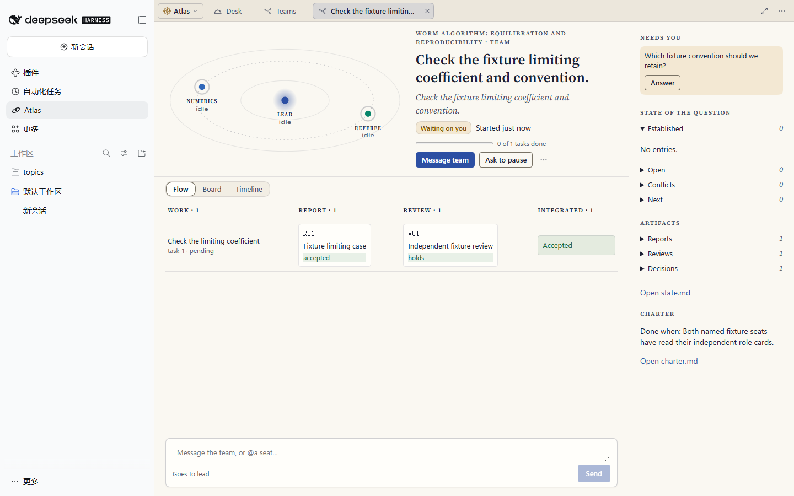

# AITP Atlas

Atlas is a physics research workbench inside DeepSeek Harness (DSH). Start a question at the **Desk**, open the topic's `research.md` beside a discussion, and follow a claim back to its derivation, calculation or paper. A discussion is a DSH session; a topic note is an ordinary file. Moving a discussion to a topic does not change the note.

**[User guide](docs/guide.md)** · [Try the team example](docs/guide.md#try-the-two-seat-example) · [Install and configure](docs/guide.md#install) · [Upgrade or roll back](docs/guide.md#upgrade-and-rollback)

## Try it without installing into your profile

From a **source checkout**, with Node.js 22+ and a compatible local DSH runtime:

```sh
npm run build
npm run preview
```

Open the **exact private URL** printed by the launcher, select **Atlas** in DSH's sidebar and type `Is the worm sampler equilibrating reproducibly?` at the Desk. Inspect **Likely topic**, then press Enter. Open the topic or a cited file beside the answer. **Atlas ▾** opens destinations; the tabs next to it are things you have already opened. Stop with `q` then Enter, or Ctrl+C. This preview uses temporary research files, a separate profile and a local model with fixed replies; it does not enable model tool calls.

To try the **research lead**, run `npm run preview:inquiry` instead. Follow the printed Schwarzschild–AdS example: start with a teaching question, inspect a branching route, then review a proposed division of work. Its fixture replies demonstrate the interface, not a black-hole calculation. In a configured workspace the same [inquiry flow](docs/guide.md#follow-a-research-inquiry) uses your selected DSH model.

For a native team with two real DSH child sessions and synthetic tasks, run `npm run preview:team` **instead**. Follow its printed assembly instructions. The Desk's Team mode and **Teams → New team** open a form; neither starts a run until you choose **Start the team**. The isolated example exercises message delivery, not scientific judgment.



*Flow links the task to its report and review; the right column shows what still needs you. [See the same room in Night](docs/assets/workbench/team-night.png).*

## Where to work

| To… | Open… |
| --- | --- |
| Ask a question or resume something waiting for you | **Desk**. Leave filing on Auto, pick a topic, or choose No topic. |
| Find, rename, move or resolve a conversation | **Discussions**. Filter by topic, unread replies, unfiled work or changes to review. |
| Divide a scoped question among authors and a referee | **Teams**. Set the stopping test and limits first; inspect reports, reviews and outstanding decisions in the room. |
| Follow a research direction to its branches and evidence | **Map**, then a topic, its Current work and linked files. |
| Read a paper beside its note, study a topic, or edit a manuscript | **Library**, **Learn** or **Write**. Use **Atlas ▾ → Commands** to find these places from the keyboard. |

[AITP Research Protocol](https://github.com/bhjia-phys/AITP-Research-Protocol) supplies the methods and Skills. Keep assumptions, counterexamples and unresolved disagreements in the owning note; a model reply, completed task or accepted report is not by itself evidence for a result.

## Using your own research

A release `.tgz` contains the built workbench, [guide](docs/guide.md) and [profile installer](scripts/install-dsh.mjs), **not** the source preview or test harness. Installation is a separate decision: choose the target profile, back it up, obtain approval and fully stop that DSH profile before installing. It is not necessary to install anything to read these documents. See [Install](docs/guide.md#install) for separate checkout and tarball commands, configuration and first launch.

[MIT license](LICENSE)
