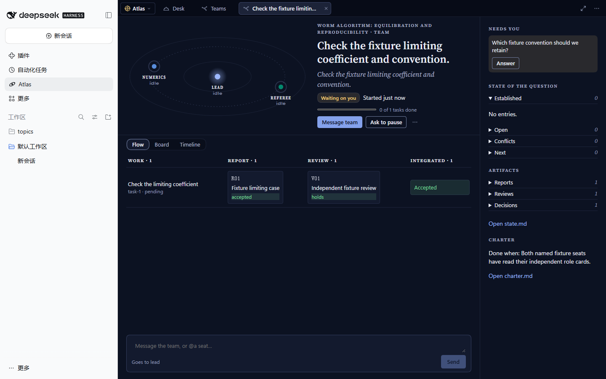

# Atlas user guide

[Overview](../README.md) · [Try a team](#try-the-two-seat-example) · [Install](#install) · [Where things live](#where-things-live) · [Upgrade and rollback](#upgrade-and-rollback)

Atlas reads a research programme from the **root folder** you configure. Its starting point is `research.md`; topics and branches have their own notes. DSH supplies the sessions, models and tools. To orient yourself in an existing programme, open **Atlas** in DSH's sidebar, then **Atlas ▾ → Map**. To resume research rather than browse, start at **Desk → Continue** or **Needs you**.

## Ask and file a question

1. At the Desk, leave the composer in **Discuss** mode. For instance, ask *“What shows that the worm sampler has equilibrated?”* Explain what observation would change your conclusion. Add a path or paper pointer with **+** if it is part of the question.
2. The topic picker defaults to **Auto**. After you pause on a draft of at least 12 characters, **Likely topic** may show matches from the *local notes*. Inspect a chip's matching terms. Only a clear top match is auto-filed; a weak or unavailable match leaves the discussion unfiled. Pick a chip or a topic to override it, or choose **No topic** explicitly. The root programme note and **Unfiled** are different choices.
3. Keep **DSH default** or pick an available model and, where supported, its reasoning effort. Press **Enter** to send, **Shift+Enter** for a new line. Atlas passes the question and its context to a new DSH session. The first auto-filed or unfiled message identifies the candidates and asks the model to flag a better topic; its reply does not move the discussion for you.
4. To continue from a source instead, select a passage and use **Ask**, **Derive** or **Check**. **Ctrl+J** opens *Ask about this*. Check the context: a file path, heading, page or line, selected text and the visible opposite pane where relevant. An attachment here is a pointer, not an uploaded copy or a grant to read other files.

In **Discussions**, use **Running**, **Needs you**, **Unread**, **Pinned**, **Unfiled**, **Resolved**, or the topic filter. **Move** changes the filing, not the research files. If **Tell the AI** is checked, Atlas waits out the six-second **Undo** window before it attempts a notification; losing the window or connection can leave a move saved without a confirmed message. Rename or pin important discussions. An unread dot is an observed reply, not a count of everything that happened while Atlas was closed.

**Other DSH sessions → Adopt** adds an eligible existing session from this workspace to the Atlas index. If a new discussion reports a session ID but no confirmed prompt, inspect that session before retrying. Closing a tab is not resolving or stopping a session. **Resolve** archives the discussion in DSH and clears its saved comparison after confirmation if there are outstanding edits. **Reopen** starts a new comparison; it does not recover the one you cleared.

## Navigate, read and write

**Atlas ▾** is the workspace menu; it is not another sidebar. The seven destinations, in shortcut order, are **Desk, Discussions, Teams, Map, Library, Learn, Write**. Search, Add or write, Commands, Theme and Keyboard shortcuts are in the same menu.

- **Map → topic:** follow a star to its opening, **Current work**, branches and linked evidence. Current work should tell the next reader what remains to be tested. If you edit a note outside Atlas, choose **Read the files again** to refresh the view.
- **Library:** use the Shelf, By topic, Knowledge index or Discover and add. Looking up an arXiv ID, DOI or INSPIRE record retrieves metadata; **Add** is the separate action that saves material. For an arXiv paper, keep the edition and provenance beside the PDF. Select a passage in a library PDF and use **Keep in note** when there is a paper map; the page link makes the citation checkable. Search covers notes and indexed paper material, not arbitrary text on every PDF page.
- **Learn:** open a topic's reading route or ask for an explanation at your level. Notes and paper links carry the argument; reading a page does not mark a research result verified.
- **Write:** open a linked LaTeX document and its PDF preview. Tab and Shift+Tab leave the source editor; Ctrl+] (⌘+] on macOS) inserts an indent. With a helper such as Outline open, focus the separator and use Left/Right to adjust the source width, or Home/End for its limits. **Ctrl+S** saves; **Ctrl+B** saves and builds using an available host TeX installation. Inspect **Problems** or the log on failure. With SyncTeX installed, Ctrl+click maps a location between source and PDF. Use **Add or write** to create a topic note or manuscript rather than editing the paper you are citing.
- **Tabs:** a link to already-open content selects its existing tab. A temporary document tab can be reused for the next preview; double-click its tab to keep it. **Shift+click** requests the other pane; **Ctrl+click** a document link requests a permanent tab in the same pane. On a narrow screen the two panes are presented as one without discarding the saved split. Use **Focus pane** for the active content; the top-edge controls let you exit or enter full screen.

### Keyboard reference

Open **Atlas ▾ → Keyboard shortcuts** for the **effective** bindings on this host. Atlas yields to DSH bindings and uses alternatives for browser-owned tab shortcuts. A key not shown there need not be available; the menu remains usable. Unmodified letters and `/` are not global shortcuts while you type in an editor.

| Action | Usual binding |
| --- | --- |
| Open destinations; go directly to a place | `Ctrl+\`; `Alt+1` through `Alt+7` in the order above |
| Commands; Search; Add or write | `Ctrl+Shift+P` (alternative `Ctrl+.`); `/`; `N` |
| New discussion; ask about current context | `Ctrl+Shift+J`; `Ctrl+J` |
| Move within Commands; open a result beside; dismiss | Arrow keys; `Shift+Enter`; `Esc`. Prefix `>` for commands, `#` for topics, `@` for discussions/teams. |
| Focus pane; full screen while focused | `Ctrl+Shift+F`; `Shift+F11`. Exit full screen before exiting Focus. |
| Next / previous tab in web DSH; close; reopen | `Ctrl+Alt+Shift+→` / `←`; `Ctrl+Alt+W`; `Ctrl+Alt+Shift+T` |
| Move the active tab to the other pane | `Ctrl+Alt+←` or `Ctrl+Alt+→` |

## Start a native team

Choose **Teams → New team** (or select **Team → Set up team…** at the Desk). First define the **question**, **Done when** and owning **topic**. For a calculation, a useful stopping test is a specified limit recovered within a stated tolerance, not “produce a report.” Record conventions, input pointers, write scope and what needs consent. Choose a template, then review each named seat, its role and whether it is core or one-shot. Expand **Brief the lead will receive** before confirming.

**Models and authority.** A model listed for the lead is not necessarily one it may delegate to. Atlas checks the real lead catalog and team/session services; where no delegation authorization is exposed it sends **no child-model override**. A referee is a separate role and task, not a guarantee of a different provider. A charter or “allowed files” line is an instruction, not an OS sandbox. Keep the DSH tool/approval policy appropriate to your workspace. Note edits and cluster jobs require the researcher's decision; answering a decision never executes a displayed command.

**Start the team** creates a run under the owning topic's `runs/`, with a charter, `state.md`, role cards, per-seat work areas, reports, reviews and decisions. Atlas binds a real lead session to the workspace, enables Agent Teams, checks review coverage for the topic note and sends the brief. The run folder, the lead's acceptance of the brief, and a child receiving its role card are **three different facts**:

- If startup fails, read the reported **stage** and open the partial team. No brief sent, delivery unconfirmed, and brief accepted require different responses. Inspect the lead transcript before another attempt; **do not resend an accepted brief**.
- A named seat becomes addressable only when its DSH parent/child identity is verified. With a readable catalog, an absent seat stays **starting** during the initial check and can become **not started** after three minutes. **Ask the lead to start it** requests the missing seat without starting a duplicate yourself. Missing information is **unknown**, not idle or failed.
- To verify what a child actually received, open its star and inspect the first task, its role-card path and the read/result in the child's conversation. A seat dot, a card file or the lead saying “started” is not a receipt from the child.

### Use the room

| Question | Where to look |
| --- | --- |
| Who is doing what? | The central star is the lead. Each member's progress ring represents its own board tasks. Enter/click a verified star to open its conversation; Down opens details. **Board** shows owners, dependencies and write scopes. |
| What supports the conclusion? | **Flow** joins Work → Report → Review → Integrated by explicit references. Open the actual report and review. An *accepted* status is the recorded verdict, not proof of correctness or of who edited a note. |
| What should happen next? | **Logbook** shows established results, open questions, conflicts and next steps from `state.md`. **Timeline** shows observed events. On a narrow pane open **Logbook**. If artifact files cannot be read, the count is incomplete, not proof that nothing needs you. |
| Who will get my message? | Plain text goes to the lead. Start with one exact `@seat` followed by your message to address that verified member; a missing or ambiguous seat does not silently redirect to the lead. |
| What needs my decision? | **Needs you → Answer** shows options and a note field. Answering writes the decision and then attempts a separate notification to the lead. If delivery is unconfirmed, check the saved answer and transcript before notifying manually; do not choose again just to resend. |

**Ask to pause**, resume and end are messages to the lead, not hard interrupts. A closing report and an idle lead establish completion. For scientific work, let each substantive file have one writer, make a separate referee test the consequential claim, and ask the lead to integrate only evidence that survives the check. Preserve disagreements and negative tests in the logbook. Review proposed changes to the topic note yourself.



*This is the same synthetic room [shown in Day](assets/workbench/team-day.png). The sample report, review and decision illustrate the views; the manual demo below does not automatically generate them.*

### Try the two-seat example

From a **source checkout** with a compatible local DSH runtime, `npm run build` then `npm run preview:team`. On the standard Windows Desktop installation the launcher locates DSH automatically; otherwise provide `DSH_EXE` as the absolute path to a compatible local DSH executable (and `DSH_CLI` if that executable needs its CLI entry). It never takes a real research root as an argument. Open the full URL it prints, then:

1. **Atlas → Atlas ▾ → Teams → New team**. Set **What should the team find out?** to `Check the fixture limiting coefficient and convention.`
2. **Done when:** `Both named fixture seats have read their independent role cards.` Select **Worm algorithm: equilibration and reproducibility** (`mc/worm`).
3. Select **Theory and numerics**, remove **theorist** and keep exactly **numerics** and **referee**. Keep default lead and inherited seat models and efforts. Choose **Start the team**.
4. Open each member's conversation. Look for its role-card read and `Fixture numerics received role card and first task.` (or `Fixture referee …`). Stop with `q` then Enter or Ctrl+C; the preview discards its profile, research and session data. Start a fresh launch to repeat. Plain `npm run preview` streams fixture text without tool calls.

## Review changes

Atlas compares eligible files with saved **baselines** (copies taken for a session). For a topic discussion the scope can include the topic note, its parent and branches; an in-focus Markdown, TeX or BibTeX file can also be watched. An unfiled question may have no file baseline. A native team's launch checks that the owning topic note is covered, not that the entire run, library or research tree is covered.

Inspect the changed sections and compare with the cited evidence before choosing **Keep** or **Revert**. An edit has **already reached the file**: Keep accepts that difference in the comparison, while Revert changes the file only if its content still matches the observed edit. Another editor or session can change a watched file; a baseline establishes a difference, **not authorship**. A missing baseline or an empty list is not proof that nothing changed elsewhere. Use the files' version history as well as independent review for important claims.

### If a feature is unavailable

Start with the message next to the control. If DSH sessions are unavailable, keep reading, searching or navigating notes; an unavailable session list is not evidence that all work stopped. If a saved model disappeared, open the model picker and explicitly choose another available model or **Use DSH default**. Atlas does not silently substitute a model for a saved choice. If **Start the team** is disabled, inspect the required fields and capability message, then use **Check again** after correcting the host configuration. Reading existing files does not require starting a new team.

## Where things live

| Location | What it holds |
| --- | --- |
| Research root | Root/topic/branch `research.md`, linked notes, manuscripts and topic `runs/` with the team's actual files. No central database replaces them. |
| Knowledge collection and library | Knowledge index, paper maps, PDFs, sources and provenance. Set `knowledge` and `library` explicitly to use an existing collection. |
| Atlas state (`stateDir`, default `~/.aitp-atlas` on the host) | Host-side discussion/team records scoped by research-root path, observed events and review baselines. Put it **outside** the research tree and back it up separately. A renamed or moved root can appear as a different workspace. |
| DSH profile/workspace | The actual sessions, transcripts, board and model/tool availability. A registry row cannot restore a deleted DSH session. |
| This browser's Atlas storage | Drafts, appearance and UI state, including root-specific tab layouts. Clearing it can lose drafts and the source for an older import; it does not erase the host registry or DSH transcripts. |

Atlas's paper lookups send identifiers/search terms to arXiv or INSPIRE; adding a paper can fetch its PDF and sources. `web: false` disables Atlas's scholarly web requests. It does **not** disable DSH's model networking or an agent's tools. Choose a root, library and DSH permissions accordingly. Opening Atlas or previewing a charter is distinct from confirming a save, download, build or team run.

## Install

Installation is **optional** and changes a DSH **profile**. The isolated preview runs from a source checkout, not from the release archive. Use Node.js 22+ and a DSH release compatible with the [`engines.dsh` range](../package.json). On Windows the installer looks for the standard Desktop installation; elsewhere it uses `dsh` on PATH unless configured otherwise.

1. Choose the target profile (`desktop` below; use `web` if that is the intended profile). Initialize it once if necessary. Back up the profile and Atlas state; get explicit approval for **this profile and package**. **Fully quit DSH Desktop or stop the target DSH web host before running the installer.** Do not run against a live work profile just to try the preview.
2. Choose **one** way to obtain the installer. In both examples `aitp-atlas-1.0.0.tgz` stands for the **actual archive filename** you built or received.

   **From the source checkout**, run in the repository root:

   ```sh
   npm run build
   npm pack
   # Only after approval; use the filename npm pack printed:
   node scripts/install-dsh.mjs desktop ./aitp-atlas-1.0.0.tgz
   ```

   **With only the release tarball**, put the archive in an empty working directory. It already contains the compiled client. Extract the bundled installer (and documentation) and pass it the original archive:

   ```sh
   tar -xzf aitp-atlas-1.0.0.tgz
   node package/scripts/install-dsh.mjs desktop ./aitp-atlas-1.0.0.tgz
   ```

   The installer invokes DSH's native plugin installer. It reuses an already-installed standalone AITP Skills dependency in that profile, otherwise it fetches a pinned AITP Skills bundle. Review the target and the possible network dependency first. Do not run `npm run build`, `preview`, or `test` from the extracted `package/`: their development scripts and fixtures are not in the distribution.

3. With DSH still closed, configure the host's **existing** research folder in that profile's `cordis.patch.yml` (normally `~/.dsh/profiles/<profile>/cordis.patch.yml`, or under `DSH_HOME`). Update an existing `id: aitp-atlas` entry instead of adding a duplicate; retain all settings you intend to keep. Example for Windows:

   ```yaml
   - id: aitp-atlas
     name: aitp-atlas
     config:
       root: C:/Research/topics
       # knowledge: C:/Research/knowledge
       # library: C:/Research/knowledge/library
       # stateDir: C:/ResearchState/atlas
       # web: false
   ```

   On a Linux host use a host-readable absolute path such as `/home/you/research/topics`; for DSH on Windows reading WSL, use its Windows path, e.g. `//wsl.localhost/Ubuntu/home/you/research/topics`. If no explicit knowledge path is set, Atlas checks the external index linked from the root note, then an existing sibling `../knowledge`, then `knowledge/` under the root. The default library is under the selected knowledge collection.

4. Restart the same profile and open **Atlas**. If the root note is missing and you intend to create it, choose **Initialize workspace**. If a path is inaccessible, correct the host configuration rather than initializing a different folder. Select **Atlas ▾ → Theme** to cycle appearances, or choose a theme by name under **Commands**. Auto follows DSH; Day and Night can be selected independently.

## Upgrade and rollback

Before upgrading, keep the previous package/installer, the stopped profile's configuration and data, the research and library trees, and the separate Atlas state. Preserve browser storage as well, especially for a pre-1.0 workspace. Test with a **copy** if root paths or shared collections will change.

Open the same Atlas origin/browser and research root you used before. Atlas imports eligible old discussion records into that root's registry by session ID; records with no verifiable local ownership are not guessed. Another browser that has its own old index may contribute additional records. Earlier browser keys are retained; tabs are restored only where content can be matched to the current scope. Old teams import separately, labelled **Legacy**: inspect their available board and members read-only. Atlas does not convert their directories to native runs or resume a writable team implicitly.

After upgrading, check a known topic, a discussion transcript and any open reviews before clearing browser storage. If records seem missing, verify the profile, root path, old browser origin and session availability first. **Do not delete registries or copy another project's records to force a match.**

To roll back, obtain approval for the previous package, stop the target DSH completely, and reinstall the known-good archive with its compatible installer/configuration or restore your backed-up profile. Restart and verify the same root. Older versions may not show work filed only in the new registry; the preserved old index is not a reverse migration. Reinstalling a plugin does not undo changes in research files, resurrect transcripts or reverse decisions. Preserve work created since the backup; restore individual data only after checking what would be lost.
